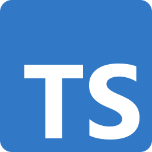
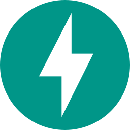
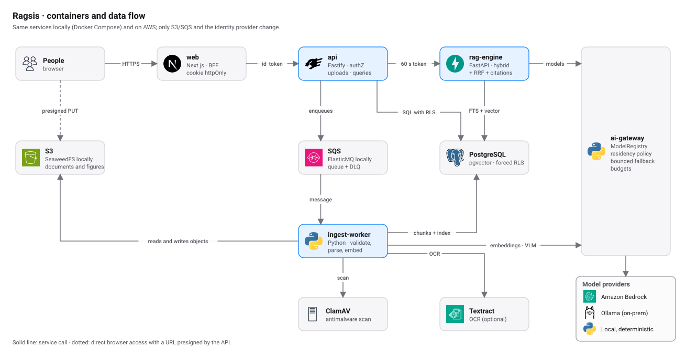
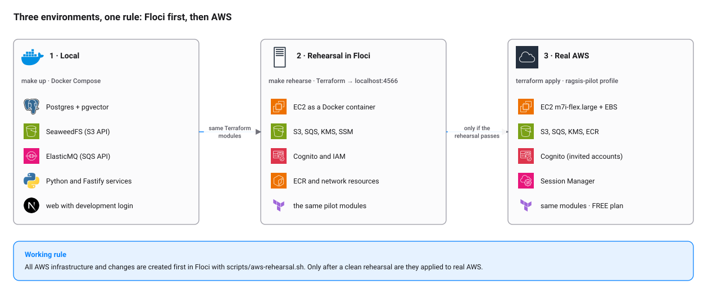

# Ragsis

Plataforma B2B de RAG empresarial: convierte documentos internos en **respuestas verificables con citas**, respetando
permisos por tenant, workspace, grupo y documento. Implementa las fases **F1 (Core SaaS)**, la parte técnica de **F2
(calidad)** y **F3 multimodal (OCR, figuras, tablas y ecuaciones, RAG-04)** del *Plan Maestro — Plataforma RAG
Empresarial AWS* v1.0.

<p>
  
  
  
  
  
  
  
  &nbsp;·&nbsp;
  
  
  
  
  
</p>

<picture>
  <source media="(prefers-color-scheme: dark)" srcset="docs/diagrams/containers-dark.svg">
  
</picture>

## Qué hace

- **Respuestas con citas verificables.** Cada cita y cada cifra deben estar en el texto citado; si falta evidencia, el
  sistema se abstiene.
- **Permisos de verdad.** El tenant se resuelve por membresía, RLS está forzada en la base y la ACL del documento se aplica
  en SQL antes de recuperar nada.
- **Documentos reales.** PDF, DOCX, PPTX, XLSX, imágenes, HTML, Markdown, TXT y CSV, con OCR, tablas, ecuaciones y figuras.
- **Más que búsqueda.** GraphRAG, agentes con política deny-by-default, workflows con revisión humana, firma electrónica y
  conectores a Gmail, Slack y ClickUp. Ver [docs/features.md](docs/features.md).
- **Funciona sin red.** El proveedor de modelos local es determinista; Bedrock y Ollama son opcionales.

## Arranque rápido

Requisitos: Docker, `uv`, `pnpm` (Node 24 o superior).

```bash
make up        # genera .env con secretos aleatorios y levanta el stack
make up-obs    # igual, con Jaeger y trazas OpenTelemetry (http://localhost:16686)
```

- Web: <http://localhost:3000> (login de desarrollo: entra con cualquier correo)
- `make seed`: crea la organización «ACME Demo (local)» con `prueba@ragsis.test` y nueve documentos para probar Ask
  ([detalle y preguntas de prueba](docs/development.md#usuario-y-datos-de-prueba))
- API: <http://localhost:4000>, con el contrato en [`packages/contracts/openapi.yaml`](packages/contracts/openapi.yaml)

Más comandos, pruebas y convenciones: [docs/development.md](docs/development.md).

## Entornos

La regla: **toda infraestructura de AWS se ensaya primero en Floci (emulador local) y solo después se crea en AWS real.**

<picture>
  <source media="(prefers-color-scheme: dark)" srcset="docs/diagrams/environments-dark.svg">
  
</picture>

| Entorno | Comando | Detalle |
|---|---|---|
| Local | `make up` | Docker Compose con SeaweedFS (S3) y ElasticMQ (SQS) |
| Ensayo | `make rehearse` | Terraform del piloto contra Floci ([guía](docs/guides/floci.md)) |
| AWS real | `terraform apply` | Piloto en `us-east-2`: una EC2, S3, SQS, KMS, ECR y Cognito ([runbook](ops/runbooks/piloto-aws.md)) |

Dónde corre cada cosa y cuánto cuesta el piloto con el plan FREE: [docs/environments.md](docs/environments.md).

## Arquitectura

```
apps/
  web/              Next.js 16: interfaz y BFF con cookie httpOnly; el login vive aquí
  api/              TypeScript/Fastify: plano de control, authZ, uploads, consultas
services/
  rag-engine/       Python/FastAPI: consulta (híbrido + RRF + rerank + verificación de citas)
  ingest-worker/    Python: SQS → validación → antimalware → parseo (+OCR, multimodal) → chunking → PII → embeddings → índice
  ai-gateway/       Python: ModelRegistry, política de residencia, fallback acotado, presupuestos
packages/
  ragsis-core/      Python: ajustes, BD con contexto RLS, token interno, utilidades de texto
  contracts/        OpenAPI v1
  policy/           Índice de pruebas de autorización
db/migrations/      Esquema, RLS forzada y funciones SECURITY DEFINER acotadas
infra/
  docker/           Compose local y del piloto
  terraform/        Módulos AWS (network, security, storage, database, compute, edge, observability) y entornos dev y pilot
ops/runbooks/       DLQ, reindex, restore, incidente cross-tenant, borrado, bootstrap de BD, piloto en AWS
eval/               Golden set, corpus de muestra y métricas
docs/               Documentación, ADR, diagramas e iconos
```

Cómo fluye un documento y una pregunta, con diagramas paso a paso: [docs/architecture.md](docs/architecture.md).

## Documentación

| Tema | Documento |
|---|---|
| Índice de todo | [docs/README.md](docs/README.md) |
| Arquitectura, modelo de datos, ingesta y consulta | [docs/architecture.md](docs/architecture.md) |
| Entornos, piloto en AWS y costos | [docs/environments.md](docs/environments.md) |
| Ensayar infraestructura en Floci | [docs/guides/floci.md](docs/guides/floci.md) |
| Variables de entorno y secretos | [docs/configuration.md](docs/configuration.md) |
| Inicio de sesión (dentro de la app, con Cognito) | [docs/authentication.md](docs/authentication.md) |
| Seguridad | [docs/security.md](docs/security.md) |
| Funciones: multimodal, GraphRAG, agentes, workflows, firma, conectores | [docs/features.md](docs/features.md) |
| Desarrollo, pruebas y CI | [docs/development.md](docs/development.md) |
| Decisiones (ADR-001 a ADR-028) | [docs/adr/README.md](docs/adr/README.md) |
| Runbooks operativos | [ops/runbooks/README.md](ops/runbooks/README.md) |

## Pruebas

```bash
make test          # pytest + vitest contra Postgres y S3 reales
make e2e           # stack completo: provisiona 2 tenants, ingesta el corpus y evalúa el golden set con metas
make tf-validate   # terraform validate del entorno dev
```

Resultado actual del E2E (`eval/golden/sample.yaml`, 18 preguntas incluidas tablas en PPTX y XLSX, proveedor local):

| Métrica | Valor | Meta piloto |
|---|---|---|
| answer accuracy | 1.00 | ≥ 0.85 |
| evidence hit rate | 1.00 | ≥ 0.85 |
| citation precision | 1.00 | ≥ 0.95 |
| abstention precision / recall | 1.00 / 1.00 | ≥ 0.90 |
| ACL leakage | 0 | 0 |

El golden set de muestra es sintético y pequeño; las metas deben medirse con 100 a 200 preguntas reales por vertical
(F0/F2).

## Seguridad (resumen)

- Tenant resuelto **solo** por membresía verificada; nunca desde el cliente. No miembro: 404.
- RLS **forzada** en todas las tablas de cliente; ACL de documento aplicada en la base antes del retrieval (ADR-008).
- Roles `ragsis_app` y `ragsis_worker` sin `BYPASSRLS`; token interno API → rag-engine de 60 s (ADR-009).
- Subida directa a S3 con URL prefirmada; cuarentena, magic bytes, MIME, cifrado, macros, ZIP bomb y ClamAV.
- Prompt con contenido documental delimitado y escapado; verificador de citas y cifras; abstención por defecto.
- Política de modelos por clasificación de datos: `restricted` nunca llama APIs externas; sin fallback silencioso a la nube.
- Auditoría con cadena de hashes por tenant; logs JSON con redacción; preguntas guardadas solo como SHA-256.

Detalle y controles de infraestructura: [docs/security.md](docs/security.md).

## Estado frente al Plan Maestro

| ID | Historia | Estado |
|---|---|---|
| SEC-01 | Aislamiento tenant end-to-end | ✅ tests negativos BD, retrieval, citas, S3 keys |
| DOC-01 | Upload y versionado seguro | ✅ |
| RAG-01 | Búsqueda semántica con citas + abstención | ✅ |
| RAG-02 | Híbrido + rerank | ✅ (RRF pgvector + FTS español; rerank por plan) |
| OBS-01 | Trazas y costo por tenant | ✅ OTel API→rag-engine→worker (W3C), query_runs con tokens/costo |
| OPS-01 | Resiliencia de ingesta | ✅ idempotencia, reintentos, DLQ, runbook |
| AUTH-02 | Roles y grupos por workspace | ✅ |
| RAG-03 | Reindex + deletion | ✅ dual-write de embeddings, full con swap atómico, purga, borrado verificable |
| API-01 | API v1 y claves de servicio | ✅ scopes, alcance por workspace, expiración, revocación, auditoría |
| AUTH-SSO | Login en la web | ✅ Cognito con formulario dentro de la app ([ADR-026](docs/adr/README.md#adr-026--login-dentro-de-la-app-con-cognito-user_password_auth)); otros IdP OIDC con Authorization Code + PKCE y logout RP-initiated |
| RAG-04 | Tablas/figuras multimodales | ✅ PPTX/XLSX/imágenes, figuras con VLM + activo S3, gráficos→tabla, ecuaciones, bbox, VLM-enhanced; Docling opcional |
| RAG-05 | GraphRAG | ✅ Entidades/relaciones en Postgres con ACL derivada de los chunks (ADR-019), modos local/global/hybrid fusionados por RRF, multi-hop con citas a chunks; por plan u organización |
| P0-01/02 | Perfil sectorial + onboarding de 9 pasos | ✅ Presets deterministas versionados, máquina de estados reanudable, espacios y agentes draft sin sobrescribir (ADR-020) |
| P0-04/05 | Agent Studio + Policy Engine | ✅ Definición declarativa, deny-by-default, sandbox con retrieval real y escrituras simuladas, publicación atada a test, versiones inmutables, rollback |
| P1-01…04 | Runtime de agentes, workflows/HITL, Approval Inbox, delegación limitada, trazas de run | ✅ Runner durable en Postgres + outbox, aprobaciones atadas a hash/versión, separación de funciones, budget, Activity (ADR-022) |
| P2-01/02 | Firma electrónica y compartición controlada | ✅ Ragsis Sign, aprobaciones, invitaciones SES, PDF final, certificado sellado y verificación pública (ADR-024) |
| CON-01 | Conectores | ✅ Gmail (personal, solo su dueño), Slack y ClickUp (empresa → workspace); OAuth+PKCE, tokens AES-GCM, delta sync con cursor/lease/backoff, tombstones y borrado al desconectar (ADR-025). Pendiente: validar con apps OAuth reales |
| HIST-01 | Historial de conversaciones | ✅ Ask guarda cada turno en una conversación privada de su autor (RLS), con lista, reapertura por enlace `?c=`, renombrar y borrar; al releer se oculta todo turno cuyo documento citado ya no es visible (ADR-028). Pendiente: retención configurable y pasar el contexto previo al modelo |
| INFRA-PILOT | Piloto de bajo costo en AWS | ✅ Terraform y Compose en una EC2 (us-east-2); ensayo previo en Floci (ADR-027). Pendiente: redeploy con el login nuevo |
| ENT-01/02, AGT-01 | Dedicado, offline, agentic | ⏳ P2/P3 |

Pendientes conocidos antes de producción: validar Textract y Bedrock (incluida la visión de Nova y Claude) en la
cuenta y región reales (aquí se probaron con dobles de prueba), validar Docling y su OCR local en la imagen del worker,
medir el aporte de las descripciones VLM con el golden set real, refresh tokens de sesión, colector ADOT en ECS,
CloudFront, pentest de permisos, y los gates legales y de privacidad de la checklist (sección 20).

---

*Los iconos de AWS pertenecen a Amazon Web Services y los logotipos de tecnología a sus dueños; ver
[docs/assets/icons/README.md](docs/assets/icons/README.md). Emulador local: [Floci](https://github.com/floci-io/floci) (MIT).*
