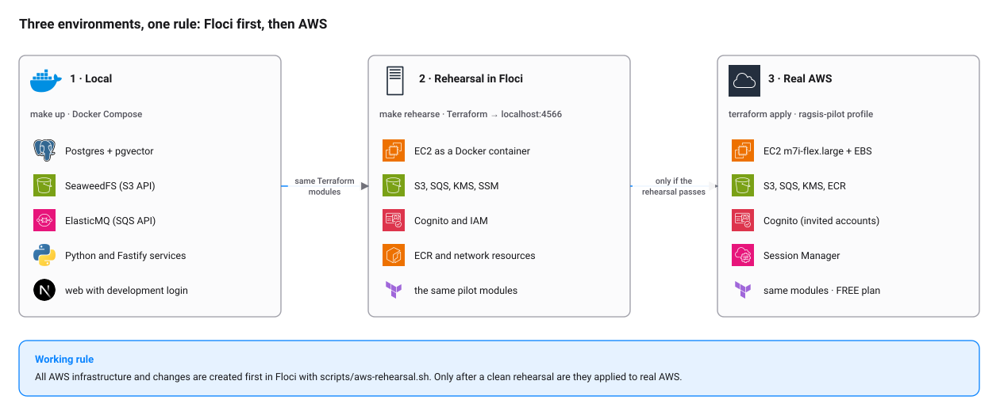

# Documentación de Ragsis

Empieza por lo que necesites:

| Quiero… | Lee |
|---|---|
| Entender cómo está construido | [architecture.md](architecture.md) |
| Levantarlo y desarrollar | [development.md](development.md) |
| Saber dónde corre cada entorno y cuánto cuesta | [environments.md](environments.md) |
| Probar infraestructura de AWS sin tocar AWS | [guides/floci.md](guides/floci.md) |
| Configurar variables y secretos | [configuration.md](configuration.md) |
| Entender el inicio de sesión | [authentication.md](authentication.md) |
| Revisar controles de seguridad | [security.md](security.md) |
| Ver qué hace cada función | [features.md](features.md) |
| Conectar Gmail, Slack o ClickUp | [connectors-setup.md](connectors-setup.md) |
| Operar el piloto en AWS | [../ops/runbooks/piloto-aws.md](../ops/runbooks/piloto-aws.md) |
| Resolver un incidente u operación | [../ops/runbooks](../ops/runbooks/README.md) |
| Saber por qué se decidió algo | [adr/README.md](adr/README.md) |

## Mapa

<picture>
  <source media="(prefers-color-scheme: dark)" srcset="diagrams/environments-dark.svg">
  
</picture>

| Carpeta | Contenido |
|---|---|
| `docs/` | Esta documentación |
| `docs/adr/` | Decisiones de arquitectura (ADR) |
| `docs/guides/` | Guías prácticas (Floci) |
| `docs/diagrams/` | Diagramas SVG generados con `make diagrams` |
| `docs/assets/icons/` | Iconos de AWS y de tecnología usados en los diagramas |
| `../ops/runbooks/` | Procedimientos operativos |

## Cómo mantener la documentación

- Un cambio de comportamiento actualiza su documento en el mismo pull request.
- Un cambio de diseño que ya no refleja un ADR agrega un ADR nuevo (no se reescribe la historia).
- Los diagramas se editan en `docs/diagrams/build.py`, nunca a mano en el SVG.
- Documentación y comentarios en español; sin secretos ni identificadores de cuenta reales en los ejemplos.
