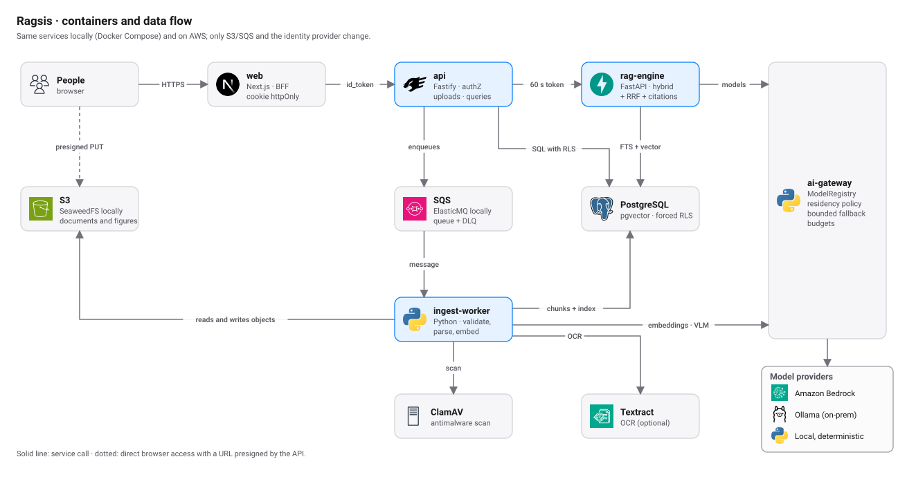
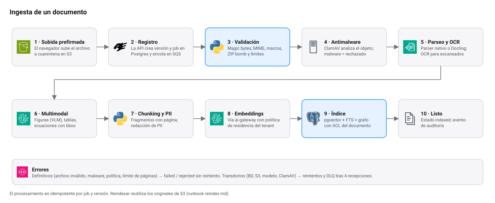
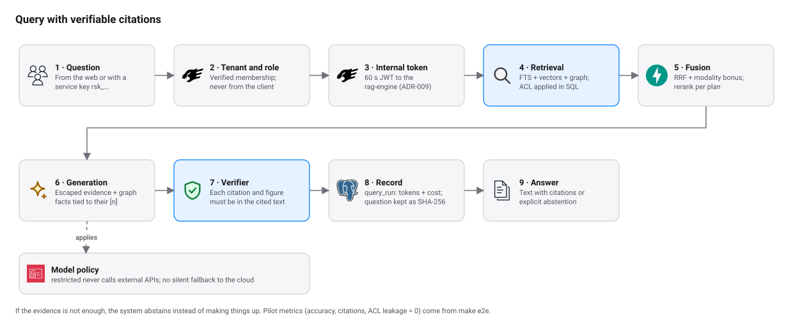

# Arquitectura

Ragsis convierte documentos internos en respuestas con citas verificables. Cada respuesta respeta el tenant, el
workspace, los grupos y el permiso del documento de quien pregunta. Este documento describe las piezas, cómo hablan
entre sí y por qué están así. Las decisiones de fondo están en los [ADR](adr/README.md).

<picture>
  <source media="(prefers-color-scheme: dark)" srcset="diagrams/containers-dark.svg">
  
</picture>

## Componentes

| Componente | Tecnología | Responsabilidad | Puerto |
|---|---|---|---|
| `apps/web` | Next.js 16 | Interfaz y BFF. Guarda la sesión en una cookie `httpOnly`; el navegador nunca ve el `id_token`. | 3000 |
| `apps/api` | TypeScript, Fastify | Plano de control: tenant y roles, ACL, uploads prefirmados, consultas, agentes, workflows, firmas, conectores. | 4000 |
| `services/rag-engine` | Python, FastAPI | Orquesta la consulta: recuperación híbrida, fusión, generación y verificación de citas. Solo acepta el token interno de la API. | 8080 (interno) |
| `services/ingest-worker` | Python | Consume SQS: valida, escanea, parsea, trocea, redacta PII, embebe e indexa. | sin puerto |
| `services/ai-gateway` | Python (librería) | `ModelRegistry`, política de residencia por clasificación de datos, fallback acotado y presupuestos. | n/a |
| `packages/ragsis-core` | Python | Ajustes, conexión a BD con contexto RLS, token interno, telemetría y utilidades de texto. | n/a |
| `packages/contracts` | OpenAPI | Contrato público de la API v1 (`openapi.yaml`). | n/a |
| PostgreSQL 17 + pgvector | Postgres | Única base: datos, ACL, vectores, búsqueda de texto completo y grafo. | 5432 |
| S3 | S3 (SeaweedFS en local) | Originales, figuras y artefactos. Versionado y cifrado. | 8333 en local |
| SQS | SQS (ElasticMQ en local) | Cola de ingesta con DLQ. | 9324 en local |
| ClamAV | ClamAV | Antimalware del worker. | 3310 |

Los servicios Python comparten `packages/ragsis-core`; la API TypeScript es independiente. El árbol completo está en
la [guía de desarrollo](development.md#mapa-del-repositorio).

## Por qué una sola base de datos

PostgreSQL con pgvector guarda texto, metadatos, permisos, vectores y grafo en la misma transacción. Así la ACL del
documento se aplica **dentro de la consulta SQL** antes de recuperar nada, y no después en la aplicación
([ADR-002](adr/README.md), [ADR-008](adr/README.md#adr-008--acl-aplicada-en-la-base-de-datos-no-solo-en-la-app)).
La contrapartida es que el índice vectorial comparte recursos con el resto; el plan maestro fija cuándo revisar eso.

## Modelo de datos

Las migraciones están en `db/migrations/` (0001 a 0013) y se aplican en orden con el rol propietario.

| Dominio | Tablas principales |
|---|---|
| Identidad y tenancy | `organizations`, `users`, `memberships`, `workspaces`, `workspace_members`, `groups`, `group_members`, `functional_roles`, `plans` |
| Documentos | `documents`, `document_versions`, `document_acl`, `document_lifecycle`, `shares` |
| Índice | `chunks`, `chunk_embeddings` (doble escritura en reindexado), `entities`, `relations`, `entity_sources`, `relation_sources` |
| Ingesta | `ingestion_jobs`, `outbox_events`, `webhook_inbox` |
| Consulta | `query_runs`, `citations`, `usage_events` |
| Agentes y workflows | `agents`, `agent_versions`, `agent_test_runs`, `workflows`, `workflow_versions`, `workflow_runs`, `run_steps`, `approvals`, `external_policies` |
| Firma electrónica | `signature_envelopes`, `signature_invitations`, `local_signatures`, `personal_signatures` |
| Conectores | `connectors`, `connector_credentials`, `connector_items`, `connector_oauth_states` |
| Onboarding y gobierno | `onboarding_sessions`, `organization_profiles`, `service_api_keys`, `audit_events` |

Reglas que no cambian:

- **RLS forzada** en todas las tablas de cliente. Los roles `ragsis_app` y `ragsis_worker` no tienen `BYPASSRLS`.
- El tenant **nunca** viene del cliente: se resuelve por membresía verificada (`apps/api/src/lib/tenant.ts`). Quien no
  es miembro recibe 404, no 403.
- Las funciones `SECURITY DEFINER` son pocas y acotadas (por ejemplo `app.upsert_user` y la búsqueda de membresía).
- `audit_events` forma una cadena de hashes por tenant (`prev_hash` → `hash`).

## Ingesta

<picture>
  <source media="(prefers-color-scheme: dark)" srcset="diagrams/ingest-dark.svg">
  
</picture>

1. El navegador sube el archivo a S3 con una URL prefirmada que emite la API. Entra a cuarentena.
2. La API registra versión y job en Postgres y encola un mensaje en SQS.
3. El worker valida magic bytes, MIME, macros, ZIP bombs y límites de tamaño y de páginas.
4. ClamAV analiza el objeto. Un positivo termina en `rejected`.
5. Parseo: nativo por defecto, Docling opcional (`PARSER_PREFERENCE`). Los escaneados pasan por OCR (`OCR_PROVIDER`:
   Textract en AWS, o `DOCLING_OCR` local).
6. Multimodal (ADR-018): tablas y ecuaciones son chunks propios con página, bbox y caption. Las figuras se describen con
   un VLM (`AI_VISION_MODEL`) y se guardan como activo citable. Sin VLM, una figura se indexa solo si tiene caption.
7. Chunking sin tiktoken (ADR-013) y redacción de PII.
8. Embeddings mediante el ai-gateway, respetando la política de modelos del tenant.
9. Índice: pgvector, texto completo en español y, si el tenant tiene grafo, entidades y relaciones con ACL derivada de
   los chunks fuente (ADR-019).
10. El documento queda `indexed` y se registra el evento de auditoría.

**Errores.** Los definitivos (archivo inválido, malware, política de modelos, límite de páginas) dejan la versión en
`failed` o `rejected` y no se reintentan. Los transitorios (BD, S3, modelo, ClamAV) se reintentan y, tras cuatro
recepciones, el mensaje va a la DLQ (runbook [dlq.md](../ops/runbooks/dlq.md)). El procesamiento es idempotente por
job y versión.

## Consulta

<picture>
  <source media="(prefers-color-scheme: dark)" srcset="diagrams/query-dark.svg">
  
</picture>

1. La pregunta llega desde la web (sesión) o con una clave de servicio `rsk_…` (scopes `query`, `documents:read`,
   `documents:write` y alcance por workspace).
2. La API resuelve tenant y rol por membresía.
3. La API emite un JWT interno de 60 s para el rag-engine (ADR-009).
4. El rag-engine recupera con texto completo en español y pgvector. La ACL se aplica en SQL.
5. Fusión con RRF y rerank según el plan. Si el grafo está activo, también modos `local`, `global` o `hybrid`; las citas
   siguen apuntando a chunks.
6. El prompt delimita y escapa el contenido documental; el ai-gateway elige el modelo según la política del tenant.
   Un tenant `restricted` nunca llama a APIs externas, y no hay fallback silencioso a la nube.
7. El verificador exige que cada cita y cada cifra estén en el texto citado. Si falta evidencia, la respuesta es una
   abstención.
8. `query_runs` guarda tokens y costo; la pregunta se guarda solo como SHA-256.
9. Se devuelve el texto con citas o la abstención.

**Saludos y cortesías.** Un mensaje que *es* un saludo, un agradecimiento, una despedida o «¿qué puedes hacer?»
(`hola`, `gracias`, `hello`, `ayuda`…) se responde con un texto fijo, en español o inglés según la frase, **antes** de
buscar nada: sin embeddings, sin recuperación, sin modelo y sin citas. Sale con `abstained: true` y
`abstain_reason: "smalltalk"` (para que agentes y workflows no lo tomen como una respuesta documental), queda registrado
en `query_runs` y **no consume la cuota mensual** de consultas. Un saludo seguido de una pregunta real («hola, ¿cuál es
el plazo de pago?») sigue el camino normal. Código: `services/rag-engine/src/ragsis_rag/smalltalk.py`.

## Proveedores de modelos

El ai-gateway oculta el proveedor detrás de identificadores `proveedor-modelo@versión`.

| Proveedor | Ejemplos | Cuándo |
|---|---|---|
| `local` | `local-hash-1024@v1`, `local-extractive@v1`, `local-lexical-rerank@v1`, `local-graph-heuristic@v1` | Desarrollo, pruebas y piloto sin red (ADR-010). Es determinista. |
| `bedrock` | `bedrock-titan-embed-v2-1024@v1`, `bedrock-nova-lite@v1`, `bedrock-claude-sonnet-5-5@v1` | AWS (ADR-003, ADR-011). |
| `ollama` | `ollama-qwen3-8b@v1`, `ollama-qwen3-vl-8b@v1` | On-premise u offline, y tenants restringidos. |

Cambiar de modelo de embeddings exige reindexar ([reindex.md](../ops/runbooks/reindex.md)).

## Agentes, workflows, firmas y conectores

Son módulos de la API que comparten la misma base y las mismas reglas de permisos. El detalle funcional está en
[features.md](features.md).

- **Agent Studio** (ADR-020): definición declarativa con política deny-by-default, sandbox con búsqueda real y
  escrituras simuladas, versiones inmutables.
- **Workflows** (ADR-022): runner durable en Postgres con outbox, revisión humana y aprobaciones atadas al hash de lo
  revisado.
- **Ragsis Sign** (ADR-024): sobres, firmas, PDF final y certificado sellado con Ed25519.
- **Conectores** (ADR-025): Gmail (personal), Slack y ClickUp con OAuth + PKCE, tokens cifrados con AES-GCM y
  sincronización delta. Guía: [connectors-setup.md](connectors-setup.md).

## Observabilidad

Las trazas son OpenTelemetry manuales (ADR-017) con contexto W3C entre API, rag-engine y worker. `make up-obs`
agrega Jaeger (<http://localhost:16686>). Los logs son JSON con redacción. En AWS, las alarmas del módulo
`observability` cubren la DLQ, 5xx del balanceador, CPU de la base y un presupuesto mensual.

## Infraestructura como código

| Ruta | Para qué |
|---|---|
| `infra/docker/compose.yml` | Stack local completo |
| `infra/docker/compose.pilot.yml` | Piloto en una EC2 (imágenes por digest) |
| `infra/terraform/modules/*` | `network`, `security`, `storage`, `database`, `compute`, `edge`, `observability` |
| `infra/terraform/envs/dev` | Entorno de referencia: ECS Fargate, ALB, RDS, WAF |
| `infra/terraform/envs/pilot` | Piloto de bajo costo: una EC2, S3, SQS, KMS, ECR, Cognito |

El piloto y el entorno de referencia comparten el módulo `storage`. Cómo se prueba cada uno está en
[environments.md](environments.md).
