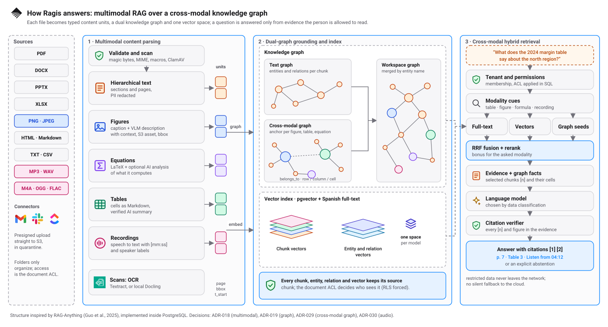

# Architecture

Ragis turns internal documents into answers with verifiable citations. Every answer respects the tenant, workspace,
groups and document permission of the person asking. This document describes the pieces, how they talk to each other and
why they are the way they are. The substantial decisions are in the [ADRs](adr/README.md).

<picture>
  <source media="(prefers-color-scheme: dark)" srcset="diagrams/containers-dark.svg">
  
</picture>

## How a question is answered

<picture>
  <source media="(prefers-color-scheme: dark)" srcset="diagrams/rag-pipeline-dark.svg">
  
</picture>

The retrieval design follows the three stages of the RAG-Anything paper (Guo et al., 2025): multimodal knowledge
unification, dual-graph construction and cross-modal hybrid retrieval. Ragis implements them itself, inside PostgreSQL,
rather than depending on that library ([ADR-004](adr/README.md), [ADR-029](adr/README.md#adr-029--cross-modal-graph-and-modality-aware-retrieval-ideas-from-rag-anything)).

| Stage | What Ragis does | Code |
|---|---|---|
| Multimodal knowledge unification | Each file becomes typed units with provenance: `text` (section, page), `figure` (caption + VLM description, S3 asset, bbox), `equation` (LaTeX, optional analysis), `table` (Markdown cells, verified summary) and `audio` (transcript span with `t_start`, `t_end`, speakers). | `ragsis_ingest/parsers/`, `multimodal.py`, `ocr.py`, `transcription.py`, `chunker.py` |
| Text knowledge graph | Entities and relations extracted per text chunk with `AI_GRAPH_MODEL`. | `ragsis_ingest/graph.py` |
| Cross-modal knowledge graph | One anchor entity per figure, table and equation, named by code (`Figura 2 · <title>`); `pertenece_a` links from the entities found in it. Tables add row, column, unit and cell relations. | `graph.py`, `table_graph.py` |
| Graph fusion | `entities.normalized_name` is unique per workspace, so a name found in a figure and in a paragraph is one node with two sources. | `db/migrations/0005_graphrag.sql` |
| Dense representation | Chunks, entity mentions and relation mentions are embedded with the same model. | `chunk_embeddings`, `entity_source_embeddings`, `relation_source_embeddings` |
| Modality-aware query | Lexical cues (figure, table, equation, recording, and their Spanish forms) set a preferred modality. | `ragsis_rag/prompting.py` (`modality_preference`) |
| Hybrid retrieval | Spanish full-text search + pgvector + graph seeds (lexical and dense), fused with RRF; the preferred modality gets half a first-place vote; optional rerank. | `ragsis_rag/retrieval.py` (`hybrid_search`, `graph_search`) |
| Synthesis | Evidence chunks plus the graph facts of those same chunks (`<grafo>`, each tied to its `[n]`), then a verifier that checks every citation and figure. | `ragsis_rag/orchestrator.py`, `verifier.py` |

Where Ragis differs from the paper, on purpose:

- **Permissions first.** Every chunk, entity, relation, vector and transcript keeps its source chunk, and the document ACL
  is applied in SQL before anything is ranked. The paper has no notion of who is asking.
- **Deterministic anchor names.** The code, not the model, names figure and table nodes, so reindexing is idempotent and
  two documents with their own "Figure 2" never merge.
- **Graph facts only from the evidence.** Facts from chunks outside the selected evidence are never added to the prompt;
  everything in the answer can be cited and verified.
- **Abstention.** If the evidence is not enough, the answer is an explicit abstention.
- **Audio** is one more modality: a transcript span is a chunk with a time range, and a citation can play from there
  ([ADR-030](adr/README.md#adr-030--audio-recordings-speech-to-text-with-timestamps)).

## Components

| Component | Technology | Responsibility | Port |
|---|---|---|---|
| `apps/web` | Next.js 16 | UI and BFF. Keeps the session in an `httpOnly` cookie; the browser never sees the `id_token`. | 3000 |
| `apps/api` | TypeScript, Fastify | Control plane: tenant and roles, ACL, presigned uploads, queries, agents, workflows, signatures, connectors. | 4000 |
| `services/rag-engine` | Python, FastAPI | Orchestrates the query: hybrid retrieval, fusion, generation and citation verification. Only accepts the API's internal token. | 8080 (internal) |
| `services/ingest-worker` | Python | Consumes SQS: validates, scans, parses (OCR, figures, tables, equations, audio), chunks, redacts PII, builds the graph, embeds and indexes. | no port |
| `services/ai-gateway` | Python (library) | `ModelRegistry` (embedding, generation, rerank, vision, OCR, transcription), residency policy by data classification, bounded fallback and budgets. | n/a |
| `packages/ragsis-core` | Python | Settings, DB connection with RLS context, internal token, telemetry and text utilities. | n/a |
| `packages/contracts` | OpenAPI | Public contract of API v1 (`openapi.yaml`). | n/a |
| PostgreSQL 17 + pgvector | Postgres | Single database: data, ACL, vectors, full-text search and graph. | 5432 |
| S3 | S3 (SeaweedFS locally) | Originals, figure images, saved transcripts and other derived assets, under `tenants/<org>/`. Versioned and encrypted. | 8333 locally |
| SQS | SQS (ElasticMQ locally) | Ingestion queue with DLQ. | 9324 locally |
| ClamAV | ClamAV | Worker antimalware. | 3310 |

The Python services share `packages/ragsis-core`; the TypeScript API is independent. The full tree is in the
[development guide](development.md#repository-map).

## Why a single database

PostgreSQL with pgvector stores text, metadata, permissions, vectors and graph in the same transaction. This way the
document ACL is applied **inside the SQL query** before anything is retrieved, and not afterwards in the application
([ADR-002](adr/README.md), [ADR-008](adr/README.md#adr-008--acl-enforced-in-the-database-not-only-in-the-app)).
The trade-off is that the vector index shares resources with everything else; the Master Plan sets when to revisit that.

## Data model

Migrations are in `db/migrations/` (0001 to 0017) and are applied in order with the owner role.

| Domain | Main tables |
|---|---|
| Identity and tenancy | `organizations`, `users`, `memberships`, `workspaces`, `workspace_members`, `groups`, `group_members`, `functional_roles`, `plans` |
| Documents | `documents`, `document_versions` (with `duration_seconds` for recordings), `document_acl`, `document_lifecycle`, `shares`, `folders`, `document_centroids` |
| Index | `chunks` (`kind`: `text`, `table`, `figure`, `equation`, `audio`), `chunk_embeddings` (dual-write during reindex), `entities`, `relations`, `entity_sources`, `relation_sources`, `entity_source_embeddings`, `relation_source_embeddings` |
| Ingestion | `ingestion_jobs`, `outbox_events`, `webhook_inbox` |
| Query and history | `query_runs`, `citations`, `usage_events`, `conversations`, `conversation_turns` |
| Agents and workflows | `agents`, `agent_versions`, `agent_test_runs`, `workflows`, `workflow_versions`, `workflow_runs`, `run_steps`, `approvals`, `external_policies` |
| E-signature | `signature_envelopes`, `signature_invitations`, `local_signatures`, `personal_signatures` |
| Connectors | `connectors`, `connector_credentials`, `connector_items`, `connector_oauth_states` |
| Onboarding and governance | `onboarding_sessions`, `organization_profiles`, `service_api_keys`, `audit_events` |

Rules that do not change:

- **RLS forced** on every customer table. The roles `ragsis_app` and `ragsis_worker` do not have `BYPASSRLS`.
- The tenant **never** comes from the client: it is resolved by verified membership (`apps/api/src/lib/tenant.ts`). A
  non-member gets 404, not 403.
- `SECURITY DEFINER` functions are few and bounded (for example `app.upsert_user` and the membership lookup).
- `audit_events` forms a per-tenant hash chain (`prev_hash` → `hash`).
- Derived rows carry the permission of their source: graph provenance and graph vectors follow the source chunk,
  `document_centroids` follows the document ACL, and `folders` only organize (they never grant access).

## Ingestion

<picture>
  <source media="(prefers-color-scheme: dark)" srcset="diagrams/ingest-dark.svg">
  
</picture>

1. The browser uploads the file to S3 with a presigned URL issued by the API. It lands in quarantine.
2. The API records the version and job in Postgres (in the chosen folder, if any) and enqueues a message in SQS.
3. The worker validates magic bytes, MIME, macros, ZIP bombs, size and page limits. Audio is checked by container
   signature (MP3, WAV, M4A, OGG, FLAC).
4. ClamAV scans the object. A positive ends in `rejected`.
5. Parsing: native by default, Docling optional (`PARSER_PREFERENCE`). Scanned files go through OCR (`OCR_PROVIDER`:
   Textract on AWS, or local `DOCLING_OCR`). Recordings go through speech to text (`TRANSCRIPTION_PROVIDER`, ADR-030);
   the transcript is saved so a reindex does not pay for it again.
6. Multimodal units (ADR-018): tables and equations are chunks of their own with page, bbox and caption. Figures are
   described with a VLM (`AI_VISION_MODEL`) and stored as a citable asset; without a VLM, a figure is indexed only if it
   has a caption. Transcript segments are grouped into spans of about 320 tokens that keep their time range.
7. Chunking without tiktoken (ADR-013) and PII redaction.
8. Knowledge graph, if the tenant has it (ADR-019, ADR-029): entities and relations from text, figure, equation and audio
   chunks; one anchor node per figure, table and equation; row, column and cell relations for tables.
9. Embeddings through the ai-gateway, respecting the tenant's model policy: chunks, entity mentions and relation
   mentions, plus one summary vector per document for folder suggestions.
10. Index: pgvector and Spanish full-text search with the document's ACL; the version becomes `indexed` and the audit
    event is recorded.

**Errors.** Permanent ones (invalid file, malware, model policy, page limit, recording too long or without speech,
no transcription provider) leave the version in `failed` or
`rejected` and are not retried. Transient ones (DB, S3, model, ClamAV) are retried and, after four receives, the
message goes to the DLQ (runbook [dlq.md](../ops/runbooks/dlq.md)). Processing is idempotent per job and version.

## Query

<picture>
  <source media="(prefers-color-scheme: dark)" srcset="diagrams/query-dark.svg">
  
</picture>

1. The question arrives from the web (session) or with a service key `rsk_…` (scopes `query`, `documents:read`,
   `documents:write` and workspace scoping).
2. The API resolves tenant and role by membership.
3. The API issues a 60 s internal JWT for the rag-engine (ADR-009).
4. The rag-engine reads modality cues in the question and retrieves with Spanish full-text search, pgvector and, if the
   graph is active, graph seeds (lexical matches plus the nearest entities and relations). The ACL is applied in SQL.
5. Fusion with RRF. Chunks of the requested modality get a bonus and can take the last evidence slot if they pass the
   evidence threshold. Rerank according to the plan. Graph modes: `auto`, `off`, `local`, `global`, `hybrid`; citations
   always point to chunks.
6. The prompt delimits and escapes document content and adds the graph facts of the selected evidence, each tagged with
   its `[n]`. Images of cited figures are attached if the generator has vision. The ai-gateway picks the model according
   to the tenant's policy: a `restricted` tenant never calls external APIs, and there is no silent fallback to the cloud.
7. The verifier requires every citation and every figure to be in the cited text. If evidence is missing, the answer is
   an abstention.
8. `query_runs` stores tokens, cost and the kind and modality of each candidate; the question is stored only as a
   SHA-256. The Ask conversation keeps the turn for its author (ADR-028).
9. The text with citations (page, table, figure, or the second of a recording), or the abstention, is returned.

**Greetings and pleasantries.** A message that *is* a greeting, a thank-you, a goodbye or "what can you do?"
(`hola`, `gracias`, `hello`, `ayuda`…) is answered with a fixed text, in Spanish or English depending on the phrase,
**before** searching anything: no embeddings, no retrieval, no model and no citations. It returns with
`abstained: true` and `abstain_reason: "smalltalk"` (so agents and workflows do not mistake it for a document answer),
is recorded in `query_runs` and **does not consume the monthly query quota**. A greeting followed by a real question
("hola, ¿cuál es el plazo de pago?") follows the normal path. Code: `services/rag-engine/src/ragsis_rag/smalltalk.py`.

## Model providers

The ai-gateway hides the provider behind identifiers of the form `provider-model@version`.

| Kind | `local` (no network) | `ollama` (on-premises) | AWS (cloud) |
|---|---|---|---|
| Embedding | `local-hash-1024@v1`, `local-hash-1024@v2` | `ollama-bge-m3@v1` | `bedrock-titan-embed-v2-1024@v1`, `bedrock-cohere-embed-multilingual-v3@v1` |
| Generation | `local-extractive@v1` | `ollama-qwen3-8b@v1`, `ollama-qwen3-14b@v1` | `bedrock-nova-micro@v1`, `bedrock-nova-lite@v1`, `bedrock-claude-sonnet-5-5@v1`, `bedrock-claude-opus-5-5@v1` |
| Rerank | `local-lexical-rerank@v1` | — | `bedrock-cohere-rerank-3-5@v1` |
| Graph extraction | `local-graph-heuristic@v1` | any generation model | any generation model |
| Vision (figures) | — | `ollama-qwen3-vl-8b@v1`, `ollama-qwen2.5vl-7b@v1` | `bedrock-nova-lite@v1`, `bedrock-claude-sonnet-5-5@v1`, `bedrock-claude-opus-5-5@v1` |
| OCR | — (Docling local OCR) | — | `aws-textract@v1` |
| Transcription | — | — | `aws-transcribe@v1` |

`local` is deterministic and used in development, tests and the offline pilot (ADR-010). `local` and `ollama` models
are allowed for `restricted` data; cloud models are not. The source of truth is
`services/ai-gateway/src/ragsis_ai/registry.py`.

Changing the embedding model requires a reindex ([reindex.md](../ops/runbooks/reindex.md)).

## Agents, workflows, signatures and connectors

These are API modules that share the same database and the same permission rules. The functional detail is in
[features.md](features.md).

- **Agent Studio** (ADR-020): declarative definition with a deny-by-default policy, sandbox with real search and
  simulated writes, immutable versions.
- **Workflows** (ADR-022): durable runner on Postgres with an outbox, human review and approvals tied to the hash of what
  was reviewed.
- **Ragsis Sign** (ADR-024): envelopes, signatures, final PDF and a certificate sealed with Ed25519.
- **Library folders** (ADR-031): nested folders per workspace with suggestions by content (document summary vectors)
  or by name. They only organize; access is still the document ACL.
- **Connectors** (ADR-025): Gmail (personal), Slack and ClickUp with OAuth + PKCE, tokens encrypted with AES-GCM and
  delta sync. Guide: [connectors-setup.md](connectors-setup.md).

## Observability

Traces are manual OpenTelemetry (ADR-017) with W3C context across API, rag-engine and worker. `make up-obs` adds Jaeger
(<http://localhost:16686>). Logs are JSON with redaction. On AWS, the alarms of the `observability` module cover the DLQ,
load balancer 5xx, database CPU and a monthly budget.

## Infrastructure as code

| Path | Used for |
|---|---|
| `infra/docker/compose.yml` | Full local stack |
| `infra/docker/compose.pilot.yml` | Pilot on one EC2 (images by digest) |
| `infra/terraform/modules/*` | `network`, `security`, `storage`, `database`, `compute`, `edge`, `observability` |
| `infra/terraform/envs/dev` | Reference environment: ECS Fargate, ALB, RDS, WAF |
| `infra/terraform/envs/pilot` | Low-cost pilot: one EC2, S3, SQS, KMS, ECR, Cognito |

The pilot and the reference environment share the `storage` module. How each one is tested is in
[environments.md](environments.md).
