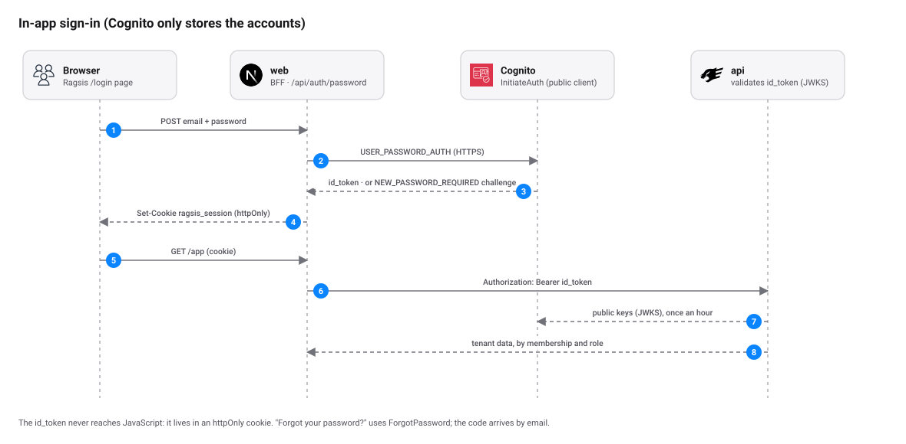

# Authentication

<picture>
  <source media="(prefers-color-scheme: dark)" srcset="diagrams/auth-dark.svg">
  
</picture>

Sign-in **happens inside the app** (`/login`), in Ragsis's own style. Cognito only stores the accounts and validates the
password; the browser never leaves the site and never sees the Cognito page.

## Modes

| `AUTH_MODE` | When | How people sign in |
|---|---|---|
| `dev` | Local development | Any email, no password. A development HS256 token signed with `JWT_DEV_SECRET` is issued. |
| `oidc` with a Cognito issuer | **Pilot and production on AWS** | Own form: email and password. See below. |
| `oidc` with another IdP | Corporate SSO | "Continue with SSO" button: Authorization Code + PKCE to the IdP (ADR-015). |

The web chooses between the second and third by looking at `OIDC_ISSUER`: if the host starts with `cognito-idp.`, it
shows the own form. All other OIDC providers keep using the redirect.

## Own form with Cognito

Implemented in `apps/web/app/login/PasswordLoginForm.tsx`, `apps/web/app/api/auth/password/route.ts` and
`apps/web/lib/cognito.ts`. It uses the Cognito public API for clients without a secret, from the web **server** (no AWS
credential is needed).

Form steps (each one is a `POST /api/auth/password` request with JSON and a `step` field):

| `step` | What it does | Cognito operation |
|---|---|---|
| `signin` | Email and password | `InitiateAuth` with `USER_PASSWORD_AUTH` |
| `new_password` | Sets the permanent password of an invited account | `RespondToAuthChallenge` (`NEW_PASSWORD_REQUIRED`) |
| `forgot` | Requests the recovery code | `ForgotPassword` |
| `reset` | Code from the email and new password | `ConfirmForgotPassword` |

What happens on sign-in:

1. The browser sends email and password to `/api/auth/password`. The route requires `Content-Type: application/json`, so
   a form on another site cannot trigger a sign-in.
2. The web calls Cognito. If the account has a temporary password, Cognito returns the `NEW_PASSWORD_REQUIRED`
   challenge; the web stores the challenge token in a 170-second `httpOnly` cookie (Cognito invalidates it after three
   minutes) and the form asks for the new password.
3. With the `id_token` in hand, the web verifies signature, issuer, audience and expiration against the Cognito JWKS.
4. It stores the `id_token` in the `ragsis_session` cookie (`httpOnly`, `SameSite=Lax`; `Secure` according to
   `SESSION_COOKIE_SECURE`, on by default). Its lifetime is that of the token itself.
5. On every call, the web forwards the token to the API as `Authorization: Bearer`. The API revalidates it (issuer,
   audience, `token_use=id`) and requires `email_verified`.

Error messages are written for people and do not reveal whether an account exists: a wrong password or email gives the
same text. Cognito responds the same way for nonexistent accounts because the client has
`prevent_user_existence_errors`.

### Accounts

Accounts are **invitation only** (`allow_admin_create_user_only`). To invite someone:

```bash
env -u AWS_ENDPOINT_URL aws cognito-idp admin-create-user \
  --profile ragsis-pilot --region us-east-2 \
  --user-pool-id <pool-id> --username person@company.com \
  --user-attributes Name=email,Value=person@company.com Name=email_verified,Value=true \
  --desired-delivery-mediums EMAIL
```

- `email_verified=true` is required: the API rejects unverified emails.
- Cognito sends the temporary password by email. On first sign-in the person chooses their own.
- The password policy is the Cognito default (minimum 8 characters, uppercase, lowercase, number and symbol).
- The role within each organization is assigned afterwards, in *Governance*; inviting someone to Cognito does not grant
  access to any tenant.

### Cognito client

Defined in `infra/terraform/envs/pilot/main.tf`: public client (no secret) with `ALLOW_USER_PASSWORD_AUTH` and
`ALLOW_REFRESH_TOKEN_AUTH`. The OAuth parameters (code + PKCE, return URLs) are kept so the redirect flow can be used
with a federated IdP later.

## Session and sign-out

- The session lasts as long as the `id_token` (one hour by default in Cognito). There are no refresh tokens yet; when it
  expires, the person signs in again. This is the open item "session refresh tokens" in the
  [README](../README.md#status-against-the-master-plan).
- **Sign out** (`/api/auth/logout`) deletes the cookie and returns to `/login`. With Cognito there is no hosted session
  to close. With other IdPs an RP-initiated logout is done if the IdP publishes `end_session_endpoint`.

## Testing without AWS

- **Development:** `AUTH_MODE=dev` (the default in `make up`).
- **OIDC redirect:** `make mock-oidc` brings up a simulated IdP at <http://localhost:9000> (`client_id` `ragsis-web`).
- **Form against Cognito:** start the web with `AUTH_MODE=oidc`, `OIDC_ISSUER`, `OIDC_CLIENT_ID`,
  `SESSION_COOKIE_SECURE=false` and `PUBLIC_BASE_URL=http://localhost:<port>`. A test with fake credentials returns
  "Wrong email or password.", a sign that the flow is enabled on the client.

## Relation to other documents

- Original decision for redirect login: [ADR-015](adr/README.md#adr-015--web-oidc-login-in-the-bff-authorization-code--pkce).
- Revision for Cognito: [ADR-026](adr/README.md#adr-026--in-app-login-with-cognito-user_password_auth).
- Threat model and controls: [security.md](security.md).
