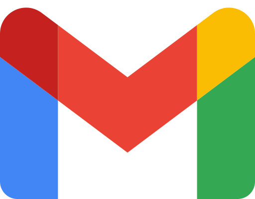

# Connectors: how to create the Google, Slack and ClickUp apps

<p>
  &nbsp;
  &nbsp;
  
</p>

Guide to enabling the CON-01 connectors (ADR-025). Without these credentials the **Connected apps** page shows each app
as "Not available yet". To test without real accounts use `CONNECTORS_DEMO=1` (development only).

All three apps use the **same return URL** (redirect URI):

```
<PUBLIC_BASE_URL>/connect/callback
```

Locally: `http://localhost:3000/connect/callback`. In production, the public HTTPS URL of the web
(e.g. `https://app.yourdomain.com/connect/callback`).

## 1. Token encryption key

Tokens are stored encrypted. In production the key is required and must live in Secrets Manager:

```bash
openssl rand -base64 32
```

Store it as `CONNECTOR_ENCRYPTION_KEY`. If you change it, existing connections will have to reconnect.

## 2. Google (Gmail)

1. Go to [Google Cloud Console](https://console.cloud.google.com/) and create (or pick) a project.
2. **APIs & Services → Library**: search for **Gmail API** and click **Enable**.
3. **APIs & Services → OAuth consent screen**:
   - If all users are in your Google Workspace, choose **Internal**: it needs no verification.
   - Otherwise, choose **External**. In *Testing* mode only the test users you add can connect (max. 100). To open it
     to everyone, Google requires verifying the app and, because it uses a restricted scope, a security assessment
     (CASA). Expect weeks of processing.
   - Scope: `https://www.googleapis.com/auth/gmail.readonly` (read-only).
4. **APIs & Services → Credentials → Create credentials → OAuth client ID**:
   - Type: **Web application**.
   - **Authorized redirect URIs**: the return URL above.
5. Copy the ID and the secret:

```
GOOGLE_CLIENT_ID=...apps.googleusercontent.com
GOOGLE_CLIENT_SECRET=...
```

## 3. Slack

1. Go to [api.slack.com/apps](https://api.slack.com/apps) → **Create New App → From scratch**. Pick your company's
   Slack workspace.
2. **OAuth & Permissions**:
   - **Redirect URLs**: add the return URL.
   - **Bot Token Scopes**: `channels:read`, `channels:history`, `channels:join`, `groups:read`, `groups:history`,
     `users:read`, `team:read`.
3. **Basic Information → App Credentials**: copy Client ID and Client Secret:

```
SLACK_CLIENT_ID=...
SLACK_CLIENT_SECRET=...
```

4. Private channels can only be read if you invite the app in Slack (`/invite @app-name`).

> **Important.** Since May 2025, Slack limits message reading to 1 request per minute for commercially distributed apps
> outside the Slack Marketplace. An **internal** app (installed only in your company's workspace) keeps the normal
> limits. If you plan to offer the connector to several customers from a single app, review the Slack API terms with
> legal before enabling it and consider publishing the app in the Marketplace.

## 4. ClickUp

1. In ClickUp: **avatar → Settings → Apps → Create new app** (requires being a workspace admin or owner).
2. **Redirect URL(s)**: the web's domain (locally `localhost:3000`).
3. Copy Client ID and Client Secret:

```
CLICKUP_CLIENT_ID=...
CLICKUP_CLIENT_SECRET=...
```

4. ClickUp has no scopes: the connector sees the same as the person who authorizes it. Recommended: connect with a
   service account that only has access to the spaces that should be shared.

## 5. Enable

Add the variables to `.env` (local) or to Secrets Manager (AWS) and restart the API:

```bash
docker compose -f infra/docker/compose.yml --env-file .env up -d --no-deps api
```

Check in **Connected apps** that each app shows up with its **Connect** button. Each person connects Gmail themselves;
Slack and ClickUp are connected by an administrator (who picks the workspace where they can be searched).

## Variables

| Variable | Used for |
| --- | --- |
| `GOOGLE_CLIENT_ID` / `GOOGLE_CLIENT_SECRET` | Google OAuth app (Gmail) |
| `SLACK_CLIENT_ID` / `SLACK_CLIENT_SECRET` | Slack app |
| `CLICKUP_CLIENT_ID` / `CLICKUP_CLIENT_SECRET` | ClickUp app |
| `CONNECTOR_ENCRYPTION_KEY` | AES-256 key (base64, 32 bytes) for the tokens; required in production |
| `CONNECTOR_SYNC_INTERVAL_MINUTES` | How often each connection is refreshed (default 30) |
| `CONNECTOR_SYNC_ENABLED` | `false` on replicas that must not sync |
| `CONNECTORS_DEMO` | `1` = simulated data without real accounts (forbidden in production) |
