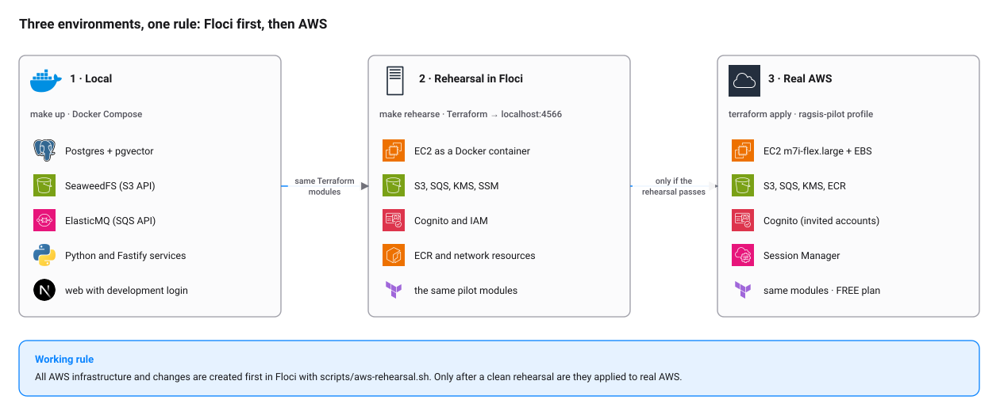
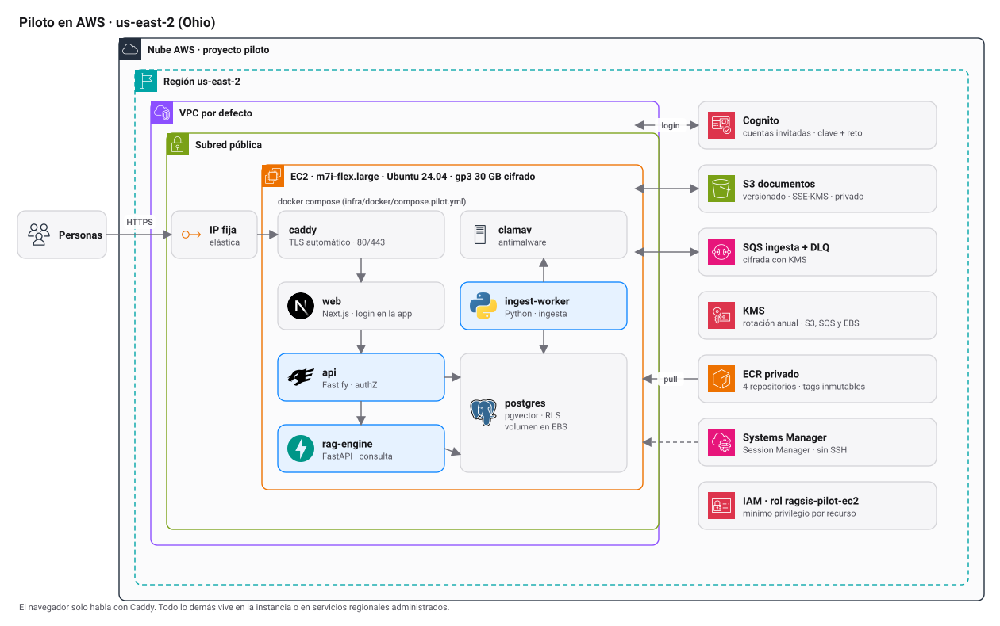

# Environments

Ragis runs in three places. The rule that ties them together: **all AWS infrastructure is created first in Floci and
only then in real AWS.**

<picture>
  <source media="(prefers-color-scheme: dark)" srcset="diagrams/environments-dark.svg">
  
</picture>

| | Local | Rehearsal in Floci | Real AWS (pilot) |
|---|---|---|---|
| Purpose | Develop and test the application | Test Terraform and AWS resources with no account or cost | Show the product to a small group |
| How it comes up | `make up` | `make rehearse` | `terraform apply` with the `ragsis-pilot` profile |
| Storage | SeaweedFS (S3 API) | Emulated S3 | S3 |
| Queue | ElasticMQ (SQS API) | Emulated SQS | SQS + DLQ |
| Identity | Development login or simulated IdP | Emulated Cognito | Cognito |
| Models | Local, deterministic | n/a | Local (Bedrock optional) |
| Cost | 0 | 0 | FREE plan credits |

The local application stack does **not** use Floci: it uses SeaweedFS and ElasticMQ because they start in seconds and
depend on nothing external. Floci is used to rehearse the infrastructure (Terraform), not to run the application.

## 1. Local

```bash
make up           # generates .env with random secrets and brings everything up
make up-obs       # same, with Jaeger (http://localhost:16686)
make infra        # only Postgres, S3 and SQS, to develop or test
make down
```

Services in `infra/docker/compose.yml`:

| Service | Image | Host port |
|---|---|---|
| `postgres` | `pgvector/pgvector:pg17` | `127.0.0.1:55432` |
| `seaweedfs` | `chrislusf/seaweedfs:3.80` | `127.0.0.1:8333` |
| `elasticmq` | `softwaremill/elasticmq-native:1.6.11` | `127.0.0.1:9324` |
| `migrate`, `bootstrap` | API image | none; they exit when done |
| `api` | `apps/api/Dockerfile` | `127.0.0.1:4000` |
| `rag-engine` | `services/rag-engine/Dockerfile` | none |
| `ingest-worker` | `services/ingest-worker/Dockerfile` | none |
| `web` | `apps/web/Dockerfile` | `127.0.0.1:3000` |
| `jaeger` (profile `observability`) | `jaegertracing/jaeger:2.5.0` | `127.0.0.1:16686`, `4318` |

By default it needs no network or credentials: it uses the local model provider. The web starts with `AUTH_MODE=dev`
(any email signs in). To test SSO without a real IdP, `make mock-oidc` brings one up at <http://localhost:9000>.

## 2. Rehearsal in Floci

[Floci](https://github.com/floci-io/floci) is a local AWS emulator (port 4566). With it the same pilot Terraform can be
applied with no AWS account and no cost. The full guide, with known limits, is in [guides/floci.md](guides/floci.md).

```bash
make rehearse-plan      # what would be created
make rehearse           # creates the resources in Floci
make rehearse-destroy   # deletes them
```

## 3. Real AWS: the pilot

<picture>
  <source media="(prefers-color-scheme: dark)" srcset="diagrams/aws-pilot-dark.svg">
  
</picture>

A single `m7i-flex.large` EC2 instance (2 vCPU, 8 GiB, Ubuntu 24.04, 30 GB encrypted gp3 EBS) runs everything with
`infra/docker/compose.pilot.yml`. Caddy terminates TLS on ports 80 and 443 and is the only thing exposed. Managed data
lives in regional services.

| Resource | Detail |
|---|---|
| Region | `us-east-2` (Ohio). All regional resources must be created there. |
| EC2 | `m7i-flex.large`, IMDSv2 required, Elastic IP, access through Session Manager (no SSH) |
| S3 | Private, versioned bucket, SSE-KMS, TLS only, CORS to the pilot origin, version lifecycle |
| SQS | Ingestion queue and DLQ encrypted with KMS |
| KMS | One key with annual rotation |
| ECR | Four repositories (`api`, `ingest-worker`, `rag-engine`, `web`) with immutable tags and scan on push |
| Cognito | User pool (LITE plan) with invited accounts only, public client with `USER_PASSWORD_AUTH` |
| IAM | `ragsis-pilot-ec2` role with least privilege per resource |

The step-by-step procedure (profile, Terraform, images, `.env.pilot`, first start and acceptance test) is in the runbook
[piloto-aws.md](../ops/runbooks/piloto-aws.md).

### Cost and credits

The pilot uses the AWS **FREE** plan: it incurs no charges while the credits (USD 100) and the plan (six months) last.
When they end, AWS suspends the account and keeps the data for 90 days so you can move to a paid plan. Joining AWS
Organizations upgrades the account to a paid plan automatically.

`m7i-flex.large` is eligible for the FREE plan, but it **consumes credits**: eligible does not mean free. Estimate with
us-east-2 list prices checked on 2026-11-10 (instance + 30 GB EBS + public IP):

| Usage | Cost per month | How long USD 100 lasts |
|---|---|---|
| 24 hours, 7 days | USD 75.95 | 1.3 months |
| 8 h for 22 days, with Elastic IP | USD 22.90 | 4.4 months |
| 8 h for 22 days, without Elastic IP | USD 20.13 | 5.0 months |

What to do:

- **Shut the instance down when you are not testing.** A stopped instance does not charge for compute, but the disk and
  the Elastic IP keep charging.
- If you accept that the IP changes on every start, release the Elastic IP.
- Documents barely affect the cost: 20 GB in S3 costs about USD 0.46 per month.
- PostgreSQL runs on the instance, on the EBS volume (USD 2.40 per month for 30 GB); there is no RDS.
- Models from Meta, Anthropic or other external providers are billed separately; AWS credits do not cover them.
- If an operation that used to work returns `AccessDenied`, check in *AWS Settings → Billing* whether the project has
  reached its spend limit.

### About `AWS_ENDPOINT_URL`

If your shell exports `AWS_ENDPOINT_URL=http://localhost:4566` (usual when working with Floci), **any `aws` command goes
to the emulator, not to real AWS**. For real AWS use `env -u AWS_ENDPOINT_URL aws …` or a clean terminal. Terraform also
needs credentials exported from the `aws login` session:

```bash
unset AWS_ENDPOINT_URL AWS_PROFILE
eval "$(aws configure export-credentials --profile ragsis-pilot --format env)"
terraform -chdir=infra/terraform/envs/pilot plan -var aws_account_id=<account-id> -var pilot_hostname=<dns>
```

## Promotion: from Floci to AWS

1. Change the Terraform or the compose file.
2. `make rehearse-plan` and `make rehearse` in Floci. Fix until they apply without errors.
3. `terraform plan` against real AWS. Check that it is a minimal change with no unexpected destructions.
4. `terraform apply` in real AWS.
5. If something fails in Floci because of an emulator limitation (not the code), note it in
   [guides/floci.md](guides/floci.md#known-limits) and validate that part directly in AWS with a bounded change.
