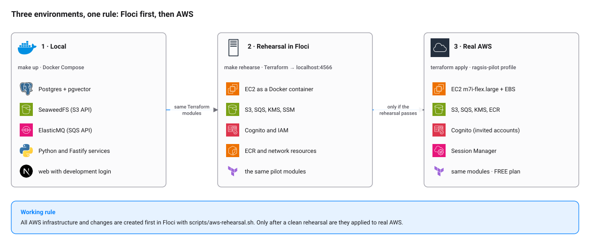

# Rehearsing infrastructure in AWS Emulator

**Rule:** every instance, bucket, queue, Cognito user or Terraform change is created first in the emulator. Only when
the rehearsal passes is it applied in real AWS. This way mistakes are made where they cost no credits.

[AWS Emulator](https://github.com/aws/aws-emulator) is the official local emulator of the AWS APIs, published by AWS
(CC0-1.0). It serves every service on one HTTPS endpoint, `https://127.0.0.1:9297`, and works with the AWS CLI, the SDKs
and the Terraform `hashicorp/aws` provider. User guide:
<https://docs.aws.amazon.com/emulator/latest/userguide/what-is-service.html>. It replaced Floci (ADR-032).

<picture>
  <source media="(prefers-color-scheme: dark)" srcset="../diagrams/environments-dark.svg">
  
</picture>

## What the emulator is and is not in this project

- **Is:** the place where `infra/terraform/envs/*` is rehearsed and individual AWS resources are tested.
- **Is not:** the storage of the local application. `make up` uses SeaweedFS (S3) and ElasticMQ (SQS), which start in
  seconds and depend on nothing external. See [environments.md](../environments.md).
- **Is not** a security test: it does not evaluate IAM or resource policies the way AWS does.

## How it differs from Floci

| | Floci (before) | AWS Emulator (now) |
|---|---|---|
| Endpoint | `http://localhost:4566` | `https://127.0.0.1:9297`, self-signed certificate |
| Credentials | anything (`test`/`test`) | SigV4 with keys generated on every start, in `~/.aws/emulator/9297/` |
| How it runs on macOS | Java process or image | Docker image built from `infra/docker/aws-emulator/Dockerfile` (AWS publishes no image) |
| State | in memory | in memory: stopping it deletes everything |
| EC2 | starts a container per instance | API only; no real instance runs |

## Starting it

```bash
make emulator-up          # = scripts/aws-emulator.sh up (builds the image the first time, ~1 min)
make emulator-down        # stops it; emulated resources are lost
scripts/aws-emulator.sh status
scripts/aws-emulator.sh logs
```

The container publishes the port on `127.0.0.1` only and runs with `--telemetry off` by default (the emulator otherwise
sends anonymous usage data to AWS; `EMULATOR_TELEMETRY=on` turns it back on). The startup log warns that it listens on
`0.0.0.0`: that is inside the container, and is expected.

To point the AWS CLI or an SDK in your shell at it:

```bash
eval "$(scripts/aws-emulator.sh env)"
aws sts get-caller-identity       # account 000000000000, user "emulator"
```

`env` sets `AWS_ENDPOINT_URL`, `AWS_SHARED_CREDENTIALS_FILE`, `AWS_CONFIG_FILE`, `AWS_CA_BUNDLE`, the region (`us-east-2`)
and unsets `AWS_ACCESS_KEY_ID`, `AWS_SECRET_ACCESS_KEY`, `AWS_SESSION_TOKEN` and `AWS_PROFILE`. Static `test` keys are
rejected.

> **Careful.** With `AWS_ENDPOINT_URL` exported, every `aws …` goes to the emulator. To touch real AWS use a new terminal
> or `env -u AWS_ENDPOINT_URL -u AWS_CONFIG_FILE -u AWS_SHARED_CREDENTIALS_FILE aws …`.

| Variable | Default | Use |
|---|---|---|
| `EMULATOR_PORT` | `9297` | Port on `127.0.0.1` (also used inside the container and in `~/.aws/emulator/<port>/`) |
| `EMULATOR_REGION` | `us-east-2` | Region printed by `env` |
| `EMULATOR_TELEMETRY` | `off` | `on` to send anonymous usage data to AWS |
| `EMULATOR_MEMORY` | `2g` | Container memory limit; over it the container dies (exit 137) and the state is lost |

The Dockerfile installs the latest **LTS** package (the only public channel). If a new release breaks the rehearsal,
pin it: `docker build --build-arg EMULATOR_CHANNEL=LTS/1.0.322 -t ragsis-aws-emulator infra/docker/aws-emulator`.

## Rehearsing the pilot

```bash
make emulator-up
make rehearse-plan      # what would be created (changes nothing)
make rehearse           # applies in the emulator
make rehearse-destroy   # deletes what was created
```

Equivalent to `scripts/aws-rehearsal.sh {plan|apply|output|destroy}`. Optional variables:

| Variable | Default | Use |
|---|---|---|
| `REHEARSAL_ENV` | `pilot` | Environment in `infra/terraform/envs` to rehearse |
| `REHEARSAL_HOSTNAME` | `piloto.ragsis.test` | Fictitious DNS name for the pilot |
| `REHEARSAL_EXCLUDE` | `aws_instance.pilot aws_eip.pilot` | Resources left out (see known limits); `""` rehearses everything |
| `REHEARSAL_INSTANCE_TYPE` | type in `main.tf` | EC2 type for the rehearsal only |
| `REHEARSAL_TARGETS` | empty | Terraform addresses (space-separated) to rehearse only part of it |

Example, storage and permissions only:

```bash
REHEARSAL_TARGETS="module.storage aws_iam_role_policy.runtime" scripts/aws-rehearsal.sh apply
```

### How it works

1. Checks that the emulator is healthy; if not, it stops with a clear message.
2. Copies `infra/terraform` to `infra/terraform/.emulator/` (ignored by Git). It does not copy state or plugins from the
   real environment.
3. Adds `providers_override.tf`: region `us-east-2`, account `000000000000`, path-style S3 and an S3 Control endpoint
   (see known limits). Endpoint, keys and certificate arrive through the variables of `scripts/aws-emulator.sh env`.
4. Adds rehearsal-only overrides for the gaps listed below. Real AWS never sees them.
5. Keeps the state in `infra/terraform/.emulator/state/<environment>.tfstate`, separate from the real state.

It never reads or modifies `infra/terraform/envs/<environment>/terraform.tfstate`.

## What counts as a "clean rehearsal"

- `plan` and `apply` finish without error and `destroy` leaves the state empty.
- The resources exist according to the AWS CLI (`aws s3api list-buckets`, `aws sqs list-queues`…).
- A second `plan` proposes no changes.

## Known limits

The emulator matches AWS most closely on control-plane APIs; Terraform support varies by service. Result of the full
pilot rehearsal with AWS Emulator 1.0.322 (LTS), Terraform 1.17.1 and provider `hashicorp/aws` 6.72.0 on macOS with
Docker Desktop (2026-11-11):

| Area | Result |
|---|---|
| Pilot `apply` | 26 resources created in about 75 s; a second `plan` proposes no changes; `destroy` empties state and emulator |
| S3, SQS + DLQ, KMS, ECR, Cognito (pool, client, domain), IAM, security groups | Created and readable |
| EC2 instance and Elastic IP | **Left out by default.** `RunInstances` works, but `DescribeTags` returns `501 NotImplemented`, and the provider calls it to read the instance back |
| Ubuntu AMI | No Canonical public SSM parameters in the emulator; the rehearsal reads the Amazon Linux 2023 one instead |
| Instance `user_data`, real performance, quotas, prices, network rules, IAM evaluation | Not emulated; validated only in AWS |

Emulator gaps the script works around (rehearsal only; all of them are worth reporting upstream as issues):

| Gap | Symptom without the workaround | Workaround in `scripts/aws-rehearsal.sh` |
|---|---|---|
| S3 Control puts the account ID in the host (`000000000000.127.0.0.1`) | `listing tags for S3 Bucket … no such host` | `endpoints.s3control = https://localhost:9297` (resolves to loopback) plus `insecure = true`, because the certificate does not cover `*.localhost` |
| `RevokeSecurityGroupEgress` ignores a `-1` rule sent with `FromPort=0/ToPort=0` (AWS ignores ports for `-1`) | `InvalidPermission.Duplicate` on `aws_vpc_security_group_egress_rule.web` | On the first apply, creates the SG alone and revokes the default rule with the CLI |
| `RunInstances` with a network interface specification is not implemented | `501 NotImplemented` | `associate_public_ip_address = null` (real AWS gets the public IP from the Elastic IP anyway) |
| `RunInstances` rejects an empty `Placement.AvailabilityZone` | `Invalid value '' for availabilityZone` | Sets the AZ of the chosen subnet |
| Canonical SSM parameters missing; names starting with `aws` cannot be created (same as AWS) | `reading SSM Parameter … couldn't find resource` | Data source reads `/aws/service/ami-amazon-linux-latest/al2023-ami-kernel-default-x86_64` |

What the rehearsal **cannot** tell you: whether `m7i-flex.large` is available in the account, whether the FREE plan
allows a service, whether the host boot finishes well, or whether the EC2 instance and Elastic IP apply cleanly. Those
are checked in the real AWS `terraform plan` and on the first start, with the instance in view. When a new emulator
release implements EC2 `DescribeTags`, try `REHEARSAL_EXCLUDE="" make rehearse`.

## Common problems

The first row quotes the script's own message, which is printed in Spanish ("AWS Emulator is not responding …").

| Symptom | Cause | Fix |
|---|---|---|
| `AWS Emulator no responde. Levántalo primero…` | The emulator is off | `make emulator-up` |
| `UnrecognizedClientException` / `InvalidClientTokenId` | Static or real credentials in the environment, or keys from a previous run | `eval "$(scripts/aws-emulator.sh env)"` again after every restart |
| `SSL: CERTIFICATE_VERIFY_FAILED` | `AWS_CA_BUNDLE` not set, or `localhost` used instead of `127.0.0.1` | Use the variables from `env` |
| Rehearsal state refers to resources that no longer exist | The emulator was restarted (state is in memory) | `rm -rf infra/terraform/.emulator/state` and apply again |
| Container exits with code 137 | Memory limit reached | `EMULATOR_MEMORY=4g make emulator-up` |
| `Error acquiring the state lock` | A previous `apply` is still alive | `pgrep -fl 'terraform -chdir'` and stop it; then repeat |
| `NoSuchBucket` or wrong account when using `aws` against real AWS | The shell still points to the emulator | New terminal, or `env -u AWS_ENDPOINT_URL -u AWS_CONFIG_FILE -u AWS_SHARED_CREDENTIALS_FILE aws …` |
| The Terraform provider finds no real AWS credentials | The provider does not read `aws login` sessions | `eval "$(aws configure export-credentials --profile ragsis-pilot --format env)"` |

## For other resources

To try an individual resource by hand (for example a new queue) before putting it in Terraform:

```bash
eval "$(scripts/aws-emulator.sh env)"
aws sqs create-queue --queue-name test
aws sqs list-queues
aws sqs delete-queue --queue-url https://sqs.us-east-2.amazonaws.com/000000000000/test
```

Then write it in Terraform, rehearse it with `make rehearse` and only then apply it in AWS.
