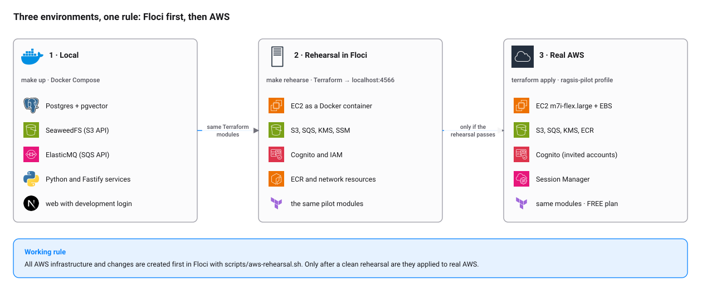

# Rehearsing infrastructure in Floci

**Rule:** every instance, bucket, queue, Cognito user or Terraform change is created first in Floci. Only when the
rehearsal passes is it applied in real AWS. This way mistakes are made where they cost no credits.

[Floci](https://github.com/floci-io/floci) is an AWS emulator that listens on `http://localhost:4566` and accepts any
credentials. It works with the AWS CLI, the SDKs and the Terraform `hashicorp/aws` provider.

<picture>
  <source media="(prefers-color-scheme: dark)" srcset="../diagrams/environments-dark.svg">
  
</picture>

## What Floci is and is not in this project

- **Is:** the place where `infra/terraform/envs/*` is rehearsed and individual AWS resources are tested.
- **Is not:** the storage of the local application. `make up` uses SeaweedFS (S3) and ElasticMQ (SQS), which start in
  seconds and depend on nothing external. See [environments.md](../environments.md).

## Starting Floci

Either way works; what matters is that `http://localhost:4566/_floci/health` responds.

```bash
# From the Floci repository (as it is run on this machine)
cd ~/Dev/floci && make build                       # only if target/quarkus-app is missing
cd ~/Dev/floci && java -jar target/quarkus-app/quarkus-run.jar

# Or with Docker
docker run --rm -p 4566:4566 -v /var/run/docker.sock:/var/run/docker.sock floci/floci:latest
```

> **Do not rebuild Floci while it is running.** `make build` deletes `target/quarkus-app`; the running JVM is left
> without its jars and stops answering KMS, ECR, Cognito and EC2 (S3 and SQS keep working because they were already
> loaded).

Variables so the AWS CLI and the SDKs talk to Floci:

```bash
export AWS_ENDPOINT_URL=http://localhost:4566
export AWS_DEFAULT_REGION=us-east-2
export AWS_ACCESS_KEY_ID=test AWS_SECRET_ACCESS_KEY=test
```

> **Careful.** With `AWS_ENDPOINT_URL` exported, every `aws …` goes to Floci. To touch real AWS use a terminal without
> that variable or `env -u AWS_ENDPOINT_URL aws …`.

## Rehearsing the pilot

```bash
make rehearse-plan      # what would be created (changes nothing)
make rehearse           # applies in Floci
make rehearse-destroy   # deletes what was created in Floci
```

Equivalent to `scripts/aws-rehearsal.sh {plan|apply|output|destroy}`. Optional variables:

| Variable | Default | Use |
|---|---|---|
| `REHEARSAL_ENV` | `pilot` | Environment in `infra/terraform/envs` to rehearse |
| `FLOCI_ENDPOINT` | `http://localhost:4566` | Another endpoint or port |
| `REHEARSAL_HOSTNAME` | `piloto.ragsis.test` | Fictitious DNS name for the pilot |
| `REHEARSAL_INSTANCE_TYPE` | `m5.large` | EC2 type for the rehearsal only (Floci does not know `m7i-flex.large`) |
| `REHEARSAL_TARGETS` | empty | Terraform addresses (space-separated) to rehearse only part of it |

Example, storage and permissions only:

```bash
REHEARSAL_TARGETS="module.storage aws_iam_role_policy.runtime" scripts/aws-rehearsal.sh apply
```

### How it works

1. Checks that Floci responds; if not, it stops with a clear message.
2. Copies `infra/terraform` to `infra/terraform/.floci/` (ignored by Git). It does not copy state or plugins from the
   real environment.
3. Adds `providers_override.tf` with fake credentials, `skip_requesting_account_id` and `s3_use_path_style`. The
   endpoint arrives through `AWS_ENDPOINT_URL`, which provider 6.x honors.
4. If the environment has `aws_instance.pilot`, adds `instance_override.tf` with an instance type that Floci knows
   (`m5.large`, same shape: 2 vCPU and 8 GiB). It only changes in the rehearsal; real AWS uses the type in `main.tf`.
5. Keeps the state in `infra/terraform/.floci/state/<environment>.tfstate`, separate from the real state.

It never reads or modifies `infra/terraform/envs/<environment>/terraform.tfstate`.

## What counts as a "clean rehearsal"

- `plan` and `apply` finish without error and `destroy` leaves the state empty.
- The resources exist according to the AWS CLI (`aws s3api list-buckets`, `aws sqs list-queues`…).
- A second `plan` proposes no changes.

## Known limits

Floci is an emulator: it validates the shape of the calls and the dependency graph, not real AWS behavior. Result of the
full pilot rehearsal with Floci 2.4.0 on macOS with Docker Desktop (2026-11-10):

| Area | Result |
|---|---|
| Pilot `plan` and `apply` | All 28 resources are created; a second `plan` proposes no changes |
| EC2 | Starts as a Docker container (`running` in about 10 s). Only with types in its catalog: `m7i-flex.large` fails with `reading EC2 Instance Type: empty result`, which is why the rehearsal uses `m5.large` |
| Elastic IP | Assigned (`127.0.0.1`); not a real public IP |
| S3, SQS, KMS, ECR, Cognito, IAM, security groups | Created. SQS and the S3 lifecycle take tens of seconds |
| Instance `user_data` | Not checked: the container starts, but there is no guarantee it installs Docker or the packages |
| Real performance, quotas, prices and network rules | Not emulated; validated only in AWS |

What the rehearsal **cannot** tell you: whether `m7i-flex.large` is available in the account, whether the FREE plan
allows a service, or whether the host boot finishes well. Those are checked in the real AWS `terraform plan` and on the
first start, with the instance in view.

## Common problems

The first row quotes the script's own message, which is printed in Spanish ("Floci is not responding at …").

| Symptom | Cause | Fix |
|---|---|---|
| `Floci no responde en http://localhost:4566` | Floci is off | Start it (see above) |
| `Error acquiring the state lock` | A previous `apply` is still alive | `pgrep -fl 'terraform -chdir'` and stop it; then repeat |
| Duplicate resources from earlier tests | Interrupted applies | Restart Floci and delete `infra/terraform/.floci/` |
| S3, SQS and IAM respond but KMS, ECR, Cognito or EC2 hang (`pending`, the call times out) | Floci's `target/quarkus-app` was deleted (`make build`, `mvn clean`) while it was running: the JVM cannot load the classes it has not used yet | Rebuild (`make build` in the Floci repository), stop the process and start it again. Do not rebuild while it runs |
| `reading EC2 Instance Type (m7i-flex.large): empty result` | The type is not in Floci's catalog | The script already replaces it with `m5.large`; change it with `REHEARSAL_INSTANCE_TYPE` |
| A repeated `apply` keeps failing with the old instance | A `tainted` instance was left in the rehearsal state | Terminate it in Floci and run `terraform state rm aws_instance.pilot` on the rehearsal state, or delete `infra/terraform/.floci/` |
| `NoSuchBucket … api` when using `aws` against real AWS | `AWS_ENDPOINT_URL` points to Floci | `env -u AWS_ENDPOINT_URL aws …` |
| The Terraform provider finds no real AWS credentials | The provider does not read `aws login` sessions | `eval "$(aws configure export-credentials --profile ragsis-pilot --format env)"` |

## For other resources

To try an individual resource by hand (for example a new queue) before putting it in Terraform:

```bash
aws sqs create-queue --queue-name test            # goes to Floci because AWS_ENDPOINT_URL is exported
aws sqs list-queues
aws sqs delete-queue --queue-url http://localhost:4566/000000000000/test
```

Then write it in Terraform, rehearse it with `make rehearse` and only then apply it in AWS.
