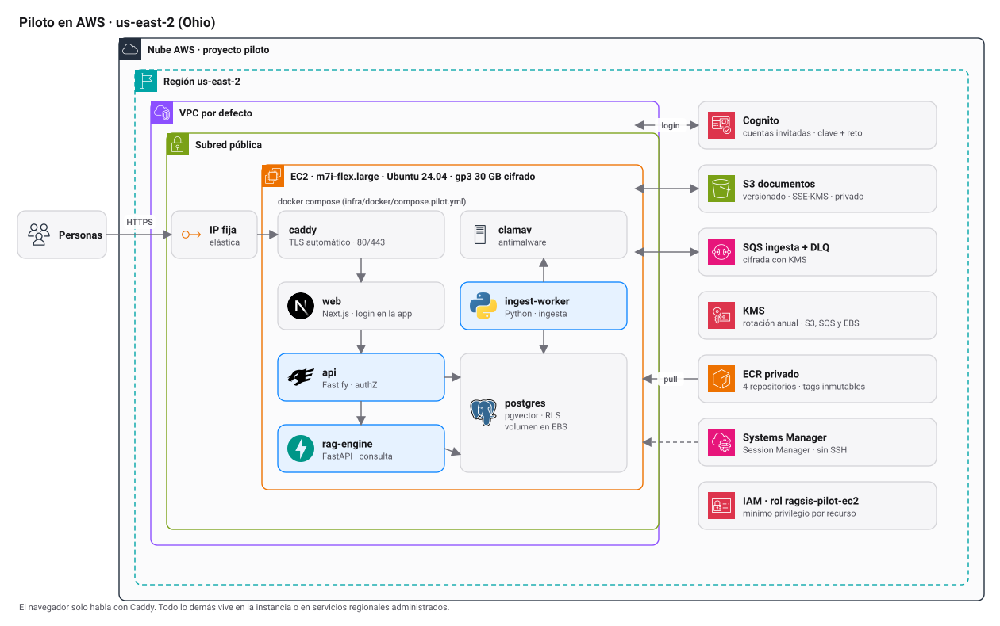

# Ragis pilot on AWS Ohio

<picture>
  <source media="(prefers-color-scheme: dark)" srcset="../../docs/diagrams/aws-pilot-dark.svg">
  
</picture>

Context, costs and decisions: [docs/environments.md](../../docs/environments.md). Variables: [docs/configuration.md](../../docs/configuration.md).

This environment uses one `m7i-flex.large` EC2 instance with 2 vCPU and 8 GiB, Ubuntu 24.04 amd64, PostgreSQL with pgvector on an encrypted EBS disk, private S3 and SQS with a DLQ. Cognito limits access to invited users. Caddy exposes the web over HTTPS and Session Manager allows administering the host. The API, database, worker, RAG engine and ClamAV talk to each other inside Docker.

The public repository has the [GitHub pilot environment](https://github.com/Manuekle/ragis/settings/environments/26787121908/edit). It stores `AWS_REGION=us-east-2`, `DEPLOY_STAGE=pilot`, `RAGSIS_ENV=production` and `AUTH_MODE=oidc`, and allows the `codex/piloto-aws` branch. The start-up described here uses images from private ECR, pushed from your machine. To automate it later, a workflow and a deployment role limited to that environment are needed. CloudShell returned `AccessDenied` when listing IAM OIDC providers. That GitHub authorization is independent of the user login in Cognito.

## Before touching AWS: rehearse in Floci

Every infrastructure change is tested first in the local emulator (Floci, `localhost:4566`). Only with a clean rehearsal do you continue with real AWS. Guide and known limits: [docs/guides/floci.md](../../docs/guides/floci.md).

```bash
make rehearse-plan      # what Terraform would create in Floci
make rehearse           # creates it in Floci
make rehearse-destroy   # deletes it
```

The rehearsal uses its own state in `infra/terraform/.floci/` and never reads or modifies the real AWS state.

## Prepare the AWS plan

1. Define a subdomain that you control, for example `pilot.yourdomain.com`. The value is used in the certificate, the Cognito callback and the S3 CORS.
2. Start a temporary `ragsis-pilot` profile for the **Rubber Ducking** project from your console account. Follow the profile's initial connection or renew it with `aws login --profile ragsis-pilot`. Select that project in the browser. [Temporary access to the AWS project](https://docs.aws.amazon.com/accounts/latest/reference/connect-ai-coding-tool.html)
3. From the repository root, run a real plan with that profile. Replace `ACCOUNT_ID` and `PILOT_HOSTNAME` with the project's data. Save the plan locally to review the resources and the expected consumption of EC2, EBS, IPv4, KMS, S3, SQS and ECR before approving the creation.

```bash
(
  unset AWS_ACCESS_KEY_ID AWS_SECRET_ACCESS_KEY AWS_SESSION_TOKEN AWS_ENDPOINT_URL
  export AWS_PROFILE=ragsis-pilot AWS_REGION=us-east-2
  export AWS_IGNORE_CONFIGURED_ENDPOINT_URLS=true
  umask 077
  aws sts get-caller-identity --query Account --output text
  terraform -chdir=infra/terraform/envs/pilot init -lockfile=readonly
  terraform -chdir=infra/terraform/envs/pilot plan \
    -var "aws_account_id=ACCOUNT_ID" \
    -var "pilot_hostname=PILOT_HOSTNAME" \
    -out=pilot.tfplan
)
```

The Terraform provider is limited to the given ID. The real plan requires read access to the project and to the AMI's public parameter. When authorizing its application, the identity also needs to create the EC2 profile and pass its role. Review the plan before running `terraform apply pilot.tfplan` in that directory. The state is local to the operator. Keep it with restricted read permissions and store it outside GitHub.

## Start-up after approval

1. When Terraform finishes, publish the four Linux amd64 images to the private repositories returned by `terraform output -json ecr_repositories`. Use a new version tag and note the four published digests. The EC2 downloads the images through its IAM profile and the ECR *credential helper*. [Private ECR authentication](https://docs.aws.amazon.com/AmazonECR/latest/userguide/registry_auth.html)

   | Image | Dockerfile |
   |---|---|
   | `api` | `apps/api/Dockerfile` |
   | `web` | `apps/web/Dockerfile` |
   | `rag-engine` | `services/rag-engine/Dockerfile` |
   | `ingest-worker` | `services/ingest-worker/Dockerfile` |

   Build each one from the root with `docker buildx build --platform linux/amd64 --load -f DOCKERFILE -t IMAGE:VERSION .`. Authenticate Docker to ECR with `aws ecr get-login-password` through standard input. Tag the image for its private repository and use `docker push` after approving the publication of the images.

2. At the DNS provider, create an A record for the subdomain pointing to `terraform output -raw dns_ipv4`. On the instance, check that `cloud-init status --wait` has finished and that `docker compose version` works.
3. Copy `infra/docker/compose.pilot.yml`, `infra/docker/Caddyfile.pilot`, `infra/docker/.env.pilot.example` and `infra/docker/postgres/10-roles.sh` to `/opt/ragsis`, keeping the `postgres/` subdirectory. You can use Systems Manager Run Command to transfer only those configuration files. The package needs neither source code nor secrets.
4. On the EC2, complete `/opt/ragsis/.env.pilot` with `0600` permissions. Use the values from `terraform output -json runtime` and the four private `repo@sha256:...` references. For the first start, generate four independent values with `openssl rand -hex 32` for the three PostgreSQL passwords and the internal secret. Keep those values when updating images to reuse the volume and keep the internal tokens' signature valid. The Cognito client is public and allows `USER_PASSWORD_AUTH`: the sign-in form lives in the web ([docs/authentication.md](../../docs/authentication.md)). Add `TURSO_DATABASE_URL` and `TURSO_AUTH_TOKEN` for the waitlist database: it is a separate Turso database, only for `/waitlist`, and shares no data with PostgreSQL.
5. From `/opt/ragsis`, start the services.

```bash
sudo docker compose --env-file .env.pilot -f compose.pilot.yml config --quiet
sudo docker compose --env-file .env.pilot -f compose.pilot.yml pull
sudo docker compose --env-file .env.pilot -f compose.pilot.yml up -d --wait --wait-timeout 420
```

## Acceptance test

- Invite two test accounts in Cognito. The login is the app's own form at `/login` (email and password); Cognito only stores the accounts and never shows its page. The temporary password from the invitation asks you to choose a new one on first sign-in, and "Forgot your password?" sends a code by email. Check the HTTPS session and that Library and Ask work with the admin and reader roles.
- Upload a DOCX, an XLSX and a PDF with text from the synthetic corpus. Verify presigned upload, SQS consumption, indexed status, citation and download. Confirm the denial with a reader outside the group.
- Check that ClamAV works, the disk space and the error queue. Set up a backup and test the PostgreSQL restore before onboarding client files.
- The configuration starts with local embeddings and generation and with the ClamAV scanner. Before using client documents, check that PDF citations open the page that contains the cited passage. Scans need real OCR if they are in scope.

## Shut down and start up to save credits

The instance consumes FREE plan credits while it runs (see [costs](../../docs/environments.md#cost-and-credits)). Shut it down when you are not testing. The containers use `restart: unless-stopped` and come back on their own when it starts.

```bash
(
  unset AWS_ENDPOINT_URL AWS_ACCESS_KEY_ID AWS_SECRET_ACCESS_KEY AWS_SESSION_TOKEN
  export AWS_PROFILE=ragsis-pilot AWS_REGION=us-east-2
  ID=$(terraform -chdir=infra/terraform/envs/pilot output -raw instance_id)
  aws ec2 stop-instances  --instance-ids "$ID"   # shut down
  # aws ec2 start-instances --instance-ids "$ID" # start up
)
```

A stopped instance does not charge for compute, but the EBS disk and the Elastic IP keep consuming credits. After starting, wait until `docker compose ps` shows all services healthy before testing the login.

## Update images

1. Rehearse the change locally (`make up`) and, if it touches Terraform, in Floci (`make rehearse`).
2. Build and publish the new images with a new tag (ECR tags are immutable) and note the digests.
3. Update the `repo@sha256:...` references in `/opt/ragsis/.env.pilot`, keeping the passwords and the internal secret.
4. Run `docker compose ... pull` and `up -d --wait` as in the initial start-up.
